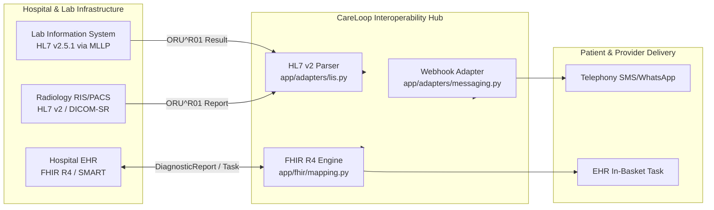

# CareLoop: Healthcare Systems Integration & Interoperability Specification

**Challenge:** Future Health Digital Innovation Challenge 2026 (Hack2skill)  
**Track:** Population Health · Challenge 05: Closing the Screening-to-Care Loop  
**Document Status:** Release Candidate (RC-1)  
**Supported Standards:** HL7 v2.5.1, HL7 FHIR Release 4 (R4), SMART on FHIR, RESTful JSON Webhooks

---

## 1. Integration Topology & Interface Strategy

CareLoop operates as a coordination layer bridging legacy healthcare infrastructure (Laboratory Information Systems, Hospital EHRs, RIS/PACS) and modern communication channels.



---

## 2. Real vs. Mocked Implementation Status

To ensure complete clarity regarding what is currently operational in the repository versus what is simulated:

```
+---------------------------------------------------------------------------------------------------------+
|                                    INTERFACE STATUS & CAPABILITY MATRIX                                 |
+---------------------+-------------------------+--------------------+------------------------------------+
| External System     | Standard / Format       | Prototype Status   | Implementation Details             |
+---------------------+-------------------------+--------------------+------------------------------------+
| Inbound Lab Feeds   | HL7 v2.5.1 ORU^R01      | Real Parser        | `app/adapters/lis.py` parses MSH,  |
|                     |                         | (Mock Ingestion)   | PID, OBR, OBX; generates Cases     |
+---------------------+-------------------------+--------------------+------------------------------------+
| Inbound Diagnostic  | FHIR R4 DiagnosticReport| Real Converter     | `app/fhir/mapping.py` maps to      |
| Reports             |                         |                    | internal case models               |
+---------------------+-------------------------+--------------------+------------------------------------+
| Outbound EHR Tasks  | FHIR R4 Task            | Real Generator     | Generates conformant FHIR Task     |
|                     |                         |                    | resources with closed-loop status  |
+---------------------+-------------------------+--------------------+------------------------------------+
| Outbound Patient    | FHIR R4                 | Real Generator     | Generates conformant               |
| Messaging Orders    | CommunicationRequest    |                    | CommunicationRequest resources     |
+---------------------+-------------------------+--------------------+------------------------------------+
| SMS / WhatsApp      | REST Webhooks (Twilio / | Mock Stateful      | `app/adapters/messaging.py` logs   |
| Gateway             | Infobip format)         | Adapter            | delivery status and simulated reads|
+---------------------+-------------------------+--------------------+------------------------------------+
| Clinic Scheduling   | FHIR R4 Appointment /   | Mock Adapter       | Slot availability and booking via  |
| System              | Schedule                |                    | internal provider directory        |
+---------------------+-------------------------+--------------------+------------------------------------+
| Large Language Model| Anthropic Messages API  | Real SDK / Mock Pr.| `app/ai/anthropic_provider.py` &   |
| Engine              | (Claude 3.5 Sonnet)     |                    | `app/ai/mock_provider.py`          |
+---------------------+-------------------------+--------------------+------------------------------------+
```

---

## 3. HL7 v2 ORU^R01 Lab Integration Specification

### 3.1 Supported Message Structure
CareLoop ingests standard HL7 v2.5.1 observational report messages (`ORU^R01`):

```text
MSH|^~\&|LAB_SYSTEM|CENTRAL_HOSPITAL|CARELOOP|DOH_NETWORK|20261112103000||ORU^R01|MSG0098412|P|2.5.1
PID|1||SYNTH-PAT-001^^^MRN||DOE^JANE||19800515|F|||123 AL KHALIDIYA ST^^ABU DHABI^^ARE||+971501234567|||AR
OBR|1||ORD-99120|FIT^Fecal Immunochemical Test^LN|||20261112090000|||||||||12345^DR_SMITH^SARAH
OBX|1|NM|FIT_VAL^Fecal Occult Blood Buffer^LN||125|ng/mL|0-99|H|||F|||20261112101500
```

### 3.2 Parser Mapping Logic (`app/adapters/lis.py`)
- **Patient Demographics (PID):** Extracts MRN, Name, Date of Birth, Gender, Address, Phone Number, and Preferred Language (`PID-15`).
- **Order Details (OBR):** Extracts Ordering Provider ID, Encounter Number, and Test Type.
- **Observation Value (OBX):** Extracts Observation Identifier, Numeric/Coded Result Value, Reference Range, and Abnormal Flag (`OBX-8`). If value exceeds pathway threshold (`fit_positive_threshold`), an active `Case` is instantiated.

---

## 4. Bidirectional FHIR R4 Interoperability

### 4.1 Inbound FHIR `DiagnosticReport` Transformation
When an external health authority exchanges data via RESTful FHIR APIs, CareLoop ingests a `DiagnosticReport` bundle and maps it into an internal `Case`:

```json
{
  "resourceType": "DiagnosticReport",
  "id": "dr-fit-synthetic-01",
  "status": "final",
  "category": [
    {
      "coding": [
        {
          "system": "http://terminology.hl7.org/CodeSystem/v2-0074",
          "code": "LAB",
          "display": "Laboratory"
        }
      ]
    }
  ],
  "code": {
    "coding": [
      {
        "system": "http://loinc.org",
        "code": "14563-1",
        "display": "Fecal occult blood by immunochemical method"
      }
    ],
    "text": "FIT Screening Test"
  },
  "subject": {
    "reference": "Patient/synth-pat-001"
  },
  "effectiveDateTime": "2026-11-12T09:00:00Z",
  "result": [
    {
      "reference": "Observation/obs-fit-synthetic-01"
    }
  ]
}
```

### 4.2 Outbound FHIR `Task` Export
To update the hospital EHR on loop closure progress, CareLoop exports a FHIR R4 `Task` resource reflecting current state machine lifecycle:

```json
{
  "resourceType": "Task",
  "id": "careloop-task-case-101",
  "status": "completed",
  "businessStatus": {
    "coding": [
      {
        "system": "https://careloop.health/codes/case-state",
        "code": "CLOSED",
        "display": "Screening Loop Closed with Verified Care Plan"
      }
    ]
  },
  "intent": "order",
  "priority": "routine",
  "code": {
    "text": "Closing the Screening-to-Care Loop"
  },
  "focus": {
    "reference": "DiagnosticReport/dr-fit-synthetic-01"
  },
  "for": {
    "reference": "Patient/synth-pat-001"
  },
  "authoredOn": "2026-11-12T10:30:00Z",
  "lastModified": "2026-11-25T14:15:00Z",
  "owner": {
    "reference": "Practitioner/clinician-dr-fatima"
  },
  "output": [
    {
      "type": {
        "text": "Closure Evidence"
      },
      "valueReference": {
        "reference": "DocumentReference/colonoscopy-report-881"
      }
    }
  ]
}
```

---

## 5. Telephony & Patient Webhook Interface

Outbound communication uses RESTful JSON contracts matching standard enterprise gateways (e.g., Twilio / Infobip):

```json
{
  "to": "+971501234567",
  "from": "CareLoop",
  "channel": "whatsapp",
  "template_id": "screening_followup_ar_v1",
  "language": "ar",
  "parameters": {
    "patient_first_name": "فاطمة",
    "screening_type": "فحص القولون الوقائي",
    "portal_action_url": "https://careloop.health/p/portal?token=eyJhbGciOi..."
  }
}
```

---

## 6. Enterprise Security & Transport Layer

1. **In-Flight Encryption:** Mandatory TLS 1.3 encryption across all inbound HL7 MLLP tunnels and outbound HTTPS webhooks.
2. **SMART-on-FHIR OAuth 2.0:** External EHR access tokens require granular scopes (`patient/DiagnosticReport.read`, `patient/Task.write`).
3. **Audit Invariance:** Every payload ingested or exported is logged to the SHA-256 hash-chain ledger with inbound source IP, certificate fingerprint, and cryptographic checksum.

