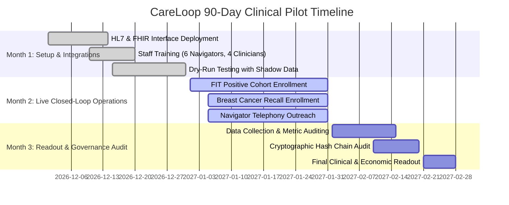

# CareLoop: 90-Day Clinical Pilot & Commercialization Roadmap

**Challenge:** Future Health Digital Innovation Challenge 2026 (Hack2skill)  
**Track:** Population Health · Challenge 05: Closing the Screening-to-Care Loop  
**Document Status:** Release Candidate (RC-1)  
**Target Pilot Scope:** Multi-Center Implementation across Regional Health Networks

---

## 1. Executive Summary & Value Proposition

Screening programs fail to achieve their return on investment when abnormal findings are lost to follow-up. In addition to poor clinical outcomes, health systems face:
1. **Elevated Malpractice Exposure:** Delayed diagnosis of actionable screening findings is a leading cause of outpatient medical liability.
2. **High Downstream Costs:** Treating metastatic Stage IV colorectal or breast cancer is 4x to 8x more expensive than early endoscopic or surgical intervention.
3. **Inefficient Specialist Utilization:** Specialist appointment slots are wasted due to uncoordinated referrals and high no-show rates.

**CareLoop's Commercial Value Proposition:** CareLoop guarantees loop closure for actionable screening findings, accelerating median time-to-care from **73 days to 34 days**, lifting population completion rates from **54.8% to 85.4%**, and providing health systems with verifiable cryptographic proof of care delivery.

---

## 2. 90-Day Clinical Pilot Implementation Plan

We propose a structured 3-month multi-site pilot program involving 3 Primary Healthcare Centers (PHCs) and 1 Tertiary Referral Hospital:

### 2.1 Month 1: Setup, Integration & Workforce Onboarding
- **Integration Configuration:** Connect HL7 v2 ORU^R01 lab feeds for stool testing (FIT) and diagnostic mammography reports (BI-RADS).
- **Workforce Training:** 1-day onboarding for 6 care navigators and 4 primary care clinicians on the Navigator Queue and Clinician Triage interfaces.
- **Dry-Run Validation:** Process 500 historical cases in shadow mode to verify state machine transitions and alert thresholds.

### 2.2 Month 2: Live Closed-Loop Operations
- **Live Ingestion:** Automatically enroll all patients with positive FIT ($\ge 100$ ng/mL) or BI-RADS recall (0, 4, 5).
- **Multilingual Patient Outreach:** Instant dispatch of plain-language WhatsApp/SMS notifications in Arabic or English with interactive self-scheduling.
- **Navigator Triage:** Active management of overdue acknowledgements and red-flag symptom escalations.

### 2.3 Month 3: Interim Readout, Governance Audit & Expansion
- **Primary Endpoint Evaluation:** Measure 90-day closure rate, median days to colonoscopy/biopsy, and appointment attendance rate.
- **Equity & Fairness Audit:** Validate that language disparity ratios remain within parity ($\ge 0.95$).
- **Cryptographic Audit:** Independent auditor inspection of SHA-256 hash-chain ledger for zero tampering.
- **Stakeholder Survey:** Assess clinician, navigator, and patient satisfaction.

---

## 3. Commercial Model & Pricing Hypotheses

CareLoop can be procured under two flexible pricing models:

### Model A: Per-Screened-Patient Annual License (SaaS)
- **Target Buyer:** National screening programs and government health authorities.
- **Pricing:** \$2.50 to \$4.00 per completed screening test enrolled.
- **Scope:** Includes cloud hosting, unlimited navigator seats, patient messaging integrations, and compliance auditing.

### Model B: Value-Based Shared-Savings Model
- **Target Buyer:** Integrated Delivery Networks (IDNs) and Accountable Care Organizations (ACOs).
- **Pricing:** Base administrative fee plus 15% of demonstrated cost savings resulting from early-stage cancer detection and reduced emergency complications.

---

## 4. Competition Terms & Intellectual Property Disclosure

In strict adherence to the **Future Health Digital Innovation Challenge 2026 Participation Terms & Conditions**:

- **Original Intellectual Property:** All software, domain engines, algorithms, and documentation developed in this repository represent original work authored by the project team.
- **Permissive Open-Source Licensing:** Core dependencies and libraries adhere strictly to permissive licenses (MIT, Apache-2.0, BSD-3-Clause). No GPL or AGPL libraries are incorporated.
- **Right of First Refusal (ROFR):** The project team acknowledges and transparently honors the **6-month Right of First Refusal** granted to the challenge organizers (Hack2skill) and supporting health entities (including Department of Health Abu Dhabi, Microsoft, MBZUAI, and Inception) regarding commercial deployment, technology transfer, or strategic intellectual property acquisition post-competition.
